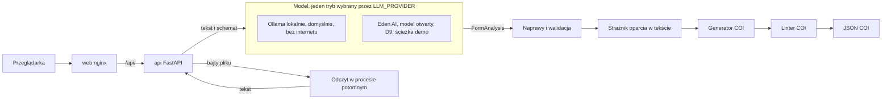
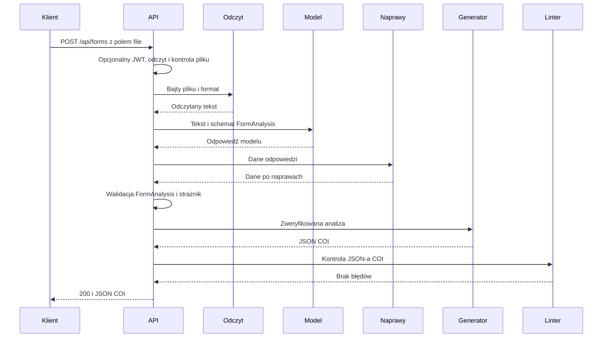
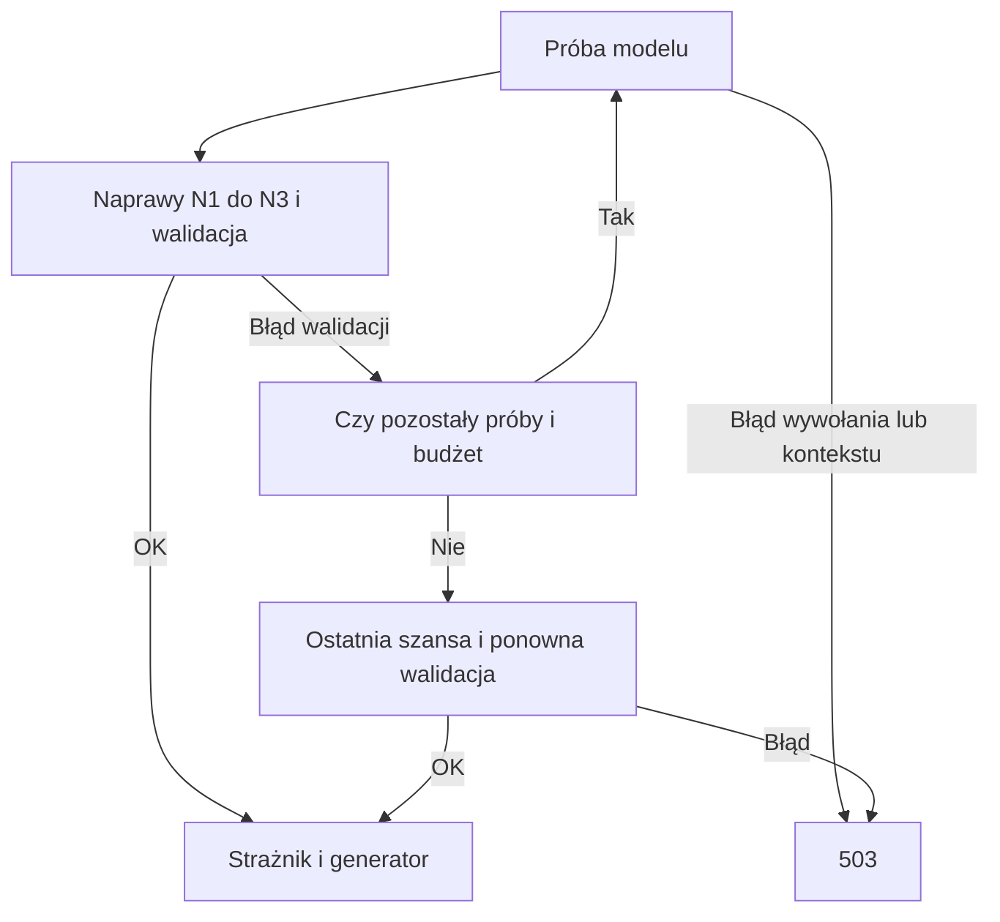

# Architektura PrzeFormuj

## Cel i zakres

PrzeFormuj zamienia papierowy formularz w jeden JSON konfiguracji eUsługi COI, także dla dokumentu z kilkoma wariantami.
Obsługiwane formaty to PDF, DOC, DOCX, ODS, XLSX, JPG/JPEG i PNG.
[Zakres w SPEC](../SPEC.md#must-at-most-5-each-visible-in-the-demo-one-owner-per-item) · [Formaty w kodzie](../backend/app/files.py#L26-L28) · [D10](../DECISIONS.md?plain=1#L377)

Poza zakresem są kreator formularzy, konta, logowanie, historia analiz i zapis plików.
Zakres wyklucza wysyłkę wypełnionych formularzy, integrację z systemem docelowym, wersję w Javie i użycie zamkniętych modeli.
Eden AI jest jedynym dopuszczonym zewnętrznym API modelu. [Wyłączenia w SPEC](../SPEC.md#out-said-out-loud-so-nobody-builds-it)

## Przegląd architektury

Diagram pokazuje drogę pliku przez proxy, odczyt w osobnym procesie, analizę w jednym z dwóch trybów modelu i kontrolę gotowego JSON-a.

Tryb modelu wybiera `LLM_PROVIDER`. Repozytorium domyślnie używa lokalnej Ollamy, która działa bez klucza i bez internetu (D9 pkt 1). Lokalny model na samym CPU nie mieści się w celu D11, więc ścieżką live demo jest Eden AI (D12 pkt 2). Ollama zostaje alternatywą bez internetu (D12 pkt 3).
[Wybór dostawcy](../backend/app/config.py#L185-L215) · [D9](../DECISIONS.md?plain=1#L365) · [D12](../DECISIONS.md?plain=1#L385)

Kontrakt web przewiduje obsługę przeglądarki i proxy ścieżki `/api/` do `api:8000`.
nginx ustawia `proxy_read_timeout 300s`. [Konfiguracja nginx](../frontend/nginx.conf#L1-L17)

| Usługa | Obraz bazowy | Użytkownik | Port hosta → kontenera | Rola |
|---|---|---|---|---|
| `api` | `docker.io/library/python:3.14.10-slim-trixie` | `app`, `USER 10001:10001` | `8000 → 8000` | FastAPI przyjmuje plik i zwraca JSON COI. [Dockerfile](../backend/Dockerfile#L4-L28) · [Compose](../docker-compose.yml#L11-L22) |
| `ollama` | `docker.io/ollama/ollama:0.40.15` | `ollama`, `USER 10002:10002` | Bez portu hosta. `11434` w sieci Compose. | Serwuje lokalny model. [Dockerfile](../ollama/Dockerfile#L4-L18) · [Compose](../docker-compose.yml#L69-L88) |
| `web` | `node:22-slim` do budowy, `nginx:1.27-alpine` do uruchomienia | Użytkownik obrazu. Proces główny nginx działa jako root. | `5173 → 80` | Serwuje aplikację i przekazuje `/api/`. [Dockerfile](../frontend/Dockerfile#L1-L11) · [Compose](../docker-compose.yml#L61-L67) |

Compose dla `web` nie ustawia `read_only`, `cap_drop` ani `no-new-privileges`.
Zmiana na nginx bez roota pozostaje otwarta. [Compose](../docker-compose.yml#L61-L67) · [Otwarty Request M1.3 (PROGRESS.api.md, Requests)](../PROGRESS.api.md#requests)

## Przepływ żądania POST /api/forms

Diagram pokazuje kolejność operacji, gdy plik i wynik analizy przechodzą kontrolę.

API przyjmuje `multipart/form-data` z jednym polem `file`. Cięższa część przebiegu działa w puli wątków API.
Sam czytnik formatu działa w osobnym procesie. [Kontrakt API](../SPEC.md#api-contract) · [Obsługa żądania](../backend/app/main.py#L78-L117) · [Proces czytnika](../backend/app/extract/sandbox.py#L93-L108)

| Kod HTTP | Odpowiedź lub dokładny tekst `detail` | Etap |
|---|---|---|
| 200 | Sam JSON formularza. | API zwraca wynik po kontroli lintera. |
| 400 | `Wybierz plik formularza.` | Brak pliku, zły multipart lub błąd walidacji żądania. |
| 400 | `Nazwa pliku jest za długa albo ma niedozwolone znaki.` | Kontrola nazwy. |
| 400 | `Nie udało się odczytać treści pliku.` | Odczyt odrzucił dokument albo analiza nie otrzymała treści. |
| 401 | `Brak tokenu dostępu albo token jest nieważny.` | JWT przed odczytem włączony i token brakujący, nieważny lub wygasły. |
| 413 | `Plik jest za duży. Limit to 10 MB.` | Limit żądania lub pliku. Komunikat zawiera ustawiony limit. |
| 415 | `Zawartość pliku nie pasuje do rozszerzenia .pdf.` | Kontrola zawartości. Komunikat zawiera rozszerzenie przesłanego pliku. |
| 415 | `Ten typ pliku nie jest obsługiwany. Wybierz PDF, DOC, DOCX, ODS, XLSX, JPG albo PNG.` | Kontrola rozszerzenia. |
| 500 | `Coś poszło nie tak. Spróbuj ponownie.` | Brak miejsca w kolejce w terminie, błąd instalacji, wyjątek serwera lub odrzucenie JSON-a przez linter. |
| 503 | `Model AI nie odpowiada. Spróbuj ponownie za chwilę.` | Błąd modelu, kontekstu lub analiza nie przeszła walidacji po dostępnych próbach i ostatniej szansie. |

[Komunikaty SPEC](../SPEC.md#api-contract) · [Upload](../backend/app/files.py#L30-L36) · [Walidacja pliku](../backend/app/files.py#L107-L170) · [JWT](../backend/app/auth.py#L20-L31) · [Odczyt](../backend/app/extract/sandbox.py#L47-L82) · [Analiza](../backend/app/analysis.py#L274-L327) · [Obsługa błędów API](../backend/app/main.py#L49-L96)

## Moduły backendu

| Moduł w `backend/app/` | Odpowiedzialność |
|---|---|
| [`main.py`](../backend/app/main.py#L78-L117) | Udostępnia trasy FastAPI i prowadzi plik przez odczyt, analizę, generator i linter. |
| [`config.py`](../backend/app/config.py#L1-L5) | Wczytuje ustawienia z otoczenia procesu i przekazuje je trasom. |
| [`auth.py`](../backend/app/auth.py#L1-L7) | Sprawdza JWT wymagany przez konfigurację API i pozwala wystawić token. |
| [`files.py`](../backend/app/files.py#L1-L6) | Czyta upload do pamięci i sprawdza nazwę, rozmiar oraz typ pliku. |
| [`errors.py`](../backend/app/errors.py#L1-L6) | Definiuje wyjątki przepływu z kodem HTTP. |
| [`models.py`](../backend/app/models.py#L1-L10) | Definiuje modele odczytanego dokumentu i analizy przekazywanej do generatora. |
| [`extract/__init__.py`](../backend/app/extract/__init__.py#L1-L5) | Uruchamia odczyt w osobnym procesie i zwraca odczytany dokument. |
| [`extract/readers.py`](../backend/app/extract/readers.py#L1-L8) | Wybiera czytnik na podstawie rozpoznanego formatu. |
| [`extract/sandbox.py`](../backend/app/extract/sandbox.py#L1-L8) | Zarządza uruchomieniem i limitami procesów odczytu. |
| [`extract/worker.py`](../backend/app/extract/worker.py#L1-L5) | Odbiera plik przez stdin i wypisuje wynik odczytu jako JSON na stdout. |
| [`extract/common.py`](../backend/app/extract/common.py#L1-L5) | Udostępnia wspólny wynik odczytu, błędy, czyszczenie tekstu i ograniczony odczyt ZIP oraz XML. |
| [`extract/doc.py`](../backend/app/extract/doc.py#L1-L8) | Odczytuje tekst binarnych dokumentów Word. |
| [`extract/docx.py`](../backend/app/extract/docx.py#L1-L8) | Odczytuje akapity, tabele, pola tekstowe i tekst z obrazów w DOCX. |
| [`extract/pdf.py`](../backend/app/extract/pdf.py#L1-L8) | Czyta warstwę tekstową PDF i kieruje wybrane obrazy stron do OCR. |
| [`extract/ocr.py`](../backend/app/extract/ocr.py#L1-L9) | Uruchamia Tesseract i scala wyniki odczytu pasów wysokiego skanu. |
| [`extract/images.py`](../backend/app/extract/images.py#L1-L8) | Czyta wymiary obrazów i tnie wysokie skany na pasy. |
| [`extract/sheets.py`](../backend/app/extract/sheets.py#L1-L8) | Czyta tekst komórek XLSX i ODS z XML w pamięci. |
| [`analysis.py`](../backend/app/analysis.py#L1-L8) | Przygotowuje tekst, kontroluje kontekst, waliduje wynik modelu i zarządza ponowieniami. |
| [`llm.py`](../backend/app/llm.py#L1-L10) | Wysyła żądanie zgodne z API OpenAI albo zwraca odpowiedź z atrapy. |
| [`repair.py`](../backend/app/repair.py#L1) | Naprawia wybrane błędy odpowiedzi przed walidacją `FormAnalysis`. |
| [`quality.py`](../backend/app/quality.py#L1-L7) | Sprawdza przesłanki w tekście i reguły jakości wyniku COI. |
| [`generator/form.py`](../backend/app/generator/form.py#L1-L8) | Składa JSON COI z `FormAnalysis`. |
| [`generator/template.py`](../backend/app/generator/template.py#L1-L8) | Buduje strony standardowe „Dane”, „Kontakt i zgody” oraz „Strona końcowa”. |
| [`generator/coi.py`](../backend/app/generator/coi.py#L1-L8) | Buduje elementy COI, w tym nazwy techniczne, warunki, pola, sekcje i strony. |
| [`lint.py`](../backend/app/lint.py#L1-L8) | Sprawdza JSON konfiguracji COI zgodnie z decyzją P2. |

## Odczyt plików (K2)

| Format | Czytnik |
|---|---|
| PDF | `pypdf` czyta warstwę tekstową. Strony z niedostatecznym tekstem kierują osadzone obrazy do OCR. |
| DOC | `olefile` otwiera kontener OLE2. Czytnik wydobywa tekst binarnego dokumentu Word. |
| DOCX | Czytnik pobiera tekst z XML i odczytuje obsługiwane obrazy osadzone przez OCR. |
| ODS, XLSX | Czytnik wydobywa tekst komórek z XML. |
| JPG/JPEG, PNG | Tesseract odczytuje obrazy. Wysokie skany mogą być dzielone na pasy. |

PDF nie jest renderowany do obrazu strony. OCR działa na wspieranych obrazach narysowanych na stronie.
Alias `.jpe` jest traktowany jak `.jpg`. Plik `.doc` zawierający DOCX trafia do czytnika DOCX.
[Zestaw czytników](../backend/app/extract/readers.py#L7-L33) · [Kontrola formatu](../backend/app/files.py#L122-L132) · [PDF](../backend/app/extract/pdf.py#L86-L115) · [K2-FINAL](../DECISIONS.md?plain=1#L234-L342)

Odczyt korzysta z `OCR_LANG`, domyślnie `pol`. Tesseract odczytuje bajty przyjęte przez stdin. [Konfiguracja](../backend/app/config.py#L200-L215) · [Odczyt](../backend/app/extract/__init__.py#L12-L16) · [OCR](../backend/app/extract/ocr.py#L109-L162)

| Zasób | Ograniczenie |
|---|---|
| Czas procesu odczytu | 60 s oczekiwania na wynik procesu. Po przekroczeniu API kończy grupę procesów. |
| Pamięć procesu | 1536 MiB przestrzeni adresowej na proces. |
| Czas CPU | Limit miękki 60 s i twardy 61 s na proces. Limity są dziedziczone przez potomków. |
| Równoległość | 2 odczyty naraz w procesie API. Kolejka czeka najwyżej 60 s na miejsce. |
| Lokalne OCR | Do 4 procesów Tesseracta na odczyt. Limit pojedynczego wywołania wynosi 30 s. |

[Limity i sygnały](../backend/app/extract/sandbox.py#L23-L82) · [Zakończenie grupy i limity systemowe](../backend/app/extract/sandbox.py#L100-L148) · [Limity OCR](../backend/app/extract/ocr.py#L22-L32)

Proces odczytu dostaje z otoczenia tylko `PATH`, `LD_LIBRARY_PATH`, `TESSDATA_PREFIX`, `LANG`, `LC_ALL` i `PYTHONDONTWRITEBYTECODE`.
Nie dostaje `JWT_SECRET` ani `LLM_API_KEY`. [Lista i jej użycie](../backend/app/extract/sandbox.py#L28-L33) · [Uruchamianie procesu](../backend/app/extract/sandbox.py#L93-L107)

Uszkodzony plik lub przekroczenie limitu odczytu daje 400. Przekroczenie czasu kolejki daje 500.
Brak Tesseracta, danych języka, wymaganej Leptoniki lub `olefile` daje 500. Szczegół trafia do logu API.
[Proces odczytu](../backend/app/extract/worker.py#L17-L43) · [Mapowanie błędów](../backend/app/extract/sandbox.py#L47-L82) · [Błędy OCR](../backend/app/extract/ocr.py#L116-L162) · [K2-FINAL](../DECISIONS.md?plain=1#L255-L260)

## Analiza modelem i gwarancja poprawności wyniku

Model opisuje formularz w kontrakcie `FormAnalysis`. Walidator D4 odrzuca brak wymaganych danych i niespójne zależności.
Generator przyjmuje analizę po walidacji. Zasady wyniku COI sprawdza linter. [Kontrakt D4](../DECISIONS.md?plain=1#L45) · [Model analizy](../backend/app/models.py#L302-L354) · [Przebieg API](../backend/app/main.py#L78-L96)

Przy każdej odpowiedzi z poprawną składnią JSON bezstratne naprawy N1–N3 poprzedzają walidację.
Usuwają duplikaty alternatyw, porządkują wybór pojedynczego identyfikatora i uzupełniają puste opcje `CHECKBOX`.
S1 zmienia `RADIO` lub `SELECT` bez opcji na `CHECKBOX` z `Tak` i dostosowuje odwołania.
S2 usuwa niespójne warunki lub ich nieprawidłowe alternatywy. Te naprawy mogą zmienić widoczność pól.
Stratne naprawy S1 i S2 działają dopiero w ostatniej szansie, przed zwrotem 503. Każda naprawa trafia do logu.
[K3.1-3](../DECISIONS.md?plain=1#L212-L233) · [Naprawy](../backend/app/repair.py#L211-L239) · [Walidacja i logi](../backend/app/analysis.py#L230-L243)

`LLM_MAX_ATTEMPTS` domyślnie wynosi 2 i dopuszcza od 1 do 3 prób.
Do sumy czasów prób API dolicza 110% czasu ostatniej próby.
Ponowienie jest dopuszczalne, gdy wynik mieści się w `LLM_ANALYSIS_BUDGET_S`, domyślnie 170 s.
Od drugiej próby włączona temperatura wynosi co najmniej 0,3. `off` nadal pomija parametr.
[Ustawienia](../backend/app/config.py#L153-L158) · [Domyślne wartości](../backend/app/config.py#L208-L215) · [Decyzja o ponowieniu](../backend/app/analysis.py#L285-L327)

Diagram pokazuje wybór między ponowieniem, ostatnią szansą i zakończeniem analizy.

Strażnik P4 sprawdza przesłanki danych wnioskodawcy i usuwa wskazane duplikaty.
Pozostałe braki oparcia zgłasza jako uwagi. W trybie `LLM_FIXTURE` API omija strażnika.
Generator wyznacza deterministyczne UUID5 z kanonicznego JSON-a analizy. Odrzucenie wyniku przez linter daje 500.
Walidacja potwierdza zgodność z kontrolowanymi regułami kontraktu i formatu. Oparcie w tekście jest osobną kontrolą P4.
[P4](../DECISIONS.md?plain=1#L60) · [Strażnik](../backend/app/quality.py#L155-L180) · [Identyfikatory](../backend/app/generator/form.py#L65-L96) · [Linter](../backend/app/lint.py#L448) · [Obsługa błędu lintera](../backend/app/main.py#L84-L96)

## Tryby modelu (D9)

| Ustawienie | Ollama, tryb domyślny | Eden AI |
|---|---|---|
| Dostawca | `LLM_PROVIDER=ollama` | `LLM_PROVIDER=edenai` |
| Adres | `http://ollama:11434/v1` w Compose | `https://api.eu.edenai.run/v3` |
| Model | `qwen3.5:4b` na `ollama/ollama:0.40.15` | `flexai/Qwen3.5-9B@eu` |
| Kontekst analizy | 32768 tokenów | 65536 tokenów |
| Limit odpowiedzi | 4096 tokenów | 16384 tokenów |
| `reasoning_effort` | `none` | `off`, czyli parametr pominięty |
| `chat_template_kwargs.enable_thinking` | Brak w domyślnym żądaniu | `false` |

[Dostawcy i lista modeli](../backend/app/config.py#L21-L37) · [Ustawienia domyślne](../backend/app/config.py#L185-L215) · [Limit odpowiedzi](../backend/app/llm.py#L51-L54) · [Compose](../docker-compose.yml#L28-L45) · [Obraz Ollamy](../ollama/Dockerfile#L1-L4)

W trybie Eden AI treść przesłanego pliku trafia do Eden AI jako odczytany tekst. OCR działa lokalnie.
Konfiguracja dopuszcza otwarte modele z `EDENAI_OPEN_MODELS` i sprawdza host oraz klucz.
Klucz podaje się wyłącznie w środowisku uruchomienia. Klient maskuje go w logowanym wycinku błędu HTTP.
[D9](../DECISIONS.md?plain=1#L365-L375) · [Walidacja dostawcy](../backend/app/config.py#L161-L178) · [Maskowanie](../backend/app/llm.py#L117-L132) · [Uruchomienie Eden](../README.md#model-w-chmurze-eden-ai-d9)

W pomiarze K3.1-3 z 22.11.2026 trasa `ovhcloud/Qwen3.5-9B` ignorowała wyłączanie myślenia.
`flexai/Qwen3.5-9B@eu` oddawała odpowiedzi bez toku rozumowania i została ustawiona jako domyślna.
Wybór trasy do użycia zatwierdza lider. [Pomiar E1](../DECISIONS.md?plain=1#L212-L233)

## Wydajność (D11, D12)

D11 wyznacza około 180 s od przyjęcia pliku do JSON-a. Granica orientacyjna wynosi 200 s.
Obrona odbywa się na x86 bez dedykowanego GPU. Czas na maszynie obrony niezmierzony (D12).
[D11](../DECISIONS.md?plain=1#L382-L384) · [D12](../DECISIONS.md?plain=1#L385-L390)

| Pomiar historyczny | Data | Wynik |
|---|---|---|
| K1, Ollama na CPU, DOCX | 21.11.2026 | 238–344 s na próbę. [K1](../DECISIONS.md?plain=1#L94-L99) |
| K3, Ollama na CPU, DOCX | 21.11.2026 | 1121 s w dwóch próbach. [K3](../DECISIONS.md?plain=1#L149) |
| K3.1-3, E1 na flexai | 22.11.2026 | 3,5–65 s na próbę. [E1](../DECISIONS.md?plain=1#L214-L222) |

Na czas żądania składają się przyjęcie pliku, kolejka, odczyt, analiza, generator i linter.
Kolejka i odczyt mają osobne limity. Klient modelu ma domyślnie timeout 120 s oraz limit połączenia 10 s.
Budżet 170 s decyduje o ponowieniu po błędzie walidacji. Pierwsze wywołanie ma własne limity klienta i kontekstu.
Suma tych etapów może przekroczyć cel D11. [Plik i przebieg](../backend/app/main.py#L78-L117) · [Kolejka i odczyt](../backend/app/extract/sandbox.py#L37-L63) · [Timeouty](../backend/app/config.py#L203-L215) · [Klient](../backend/app/llm.py#L117-L125) · [Ponowienia](../backend/app/analysis.py#L285-L324)

## Bezpieczeństwo i dane

API przetwarza przesłany plik wyłącznie w pamięci. Odczyt żądania kończy się po przekroczeniu limitu.
Domyślny limit pliku to 10 MB (10 × 1024² bajtów). Parser multipart używa bufora większego od żądania.
API sprawdza nazwę i zgodność zawartości z rozszerzeniem. [Obsługa pliku](../backend/app/files.py#L86-L170) · [Rozmiar](../backend/app/config.py#L15) · [Limit domyślny](../backend/app/config.py#L193-L203)

`frontend/nginx.conf` ustawia `client_max_body_size 25m`, ale nie ustawia `client_body_buffer_size`.
Ciało większe od bufora nginx zapisuje w całości lub części do pliku tymczasowego.
Przesłany plik może trafić na dysk kontenera `web` przed dotarciem do API.
[Konfiguracja nginx](../frontend/nginx.conf#L1-L18) · [dokumentacja nginx, dyrektywa client_body_buffer_size](https://nginx.org/en/docs/http/ngx_http_core_module.html#client_body_buffer_size)

Przy `JWT_ENABLED=true` API sprawdza token przed odczytem pliku. Akceptuje algorytmy HMAC i wymaga `exp`.
`GET /health` i `GET /api/info` działają bez tokenu. `/api/info` zwraca `llm` i `model`.
[Autoryzacja](../backend/app/auth.py#L20-L67) · [Trasy](../backend/app/main.py#L99-L117)

| Kontener | Użytkownik i ustawienia bezpieczeństwa |
|---|---|
| `api` | `USER 10001:10001`, `read_only: true`, `tmpfs: /tmp`, `cap_drop: ALL`, `no-new-privileges:true`. [Dockerfile](../backend/Dockerfile#L16-L28) · [Compose](../docker-compose.yml#L11-L22) |
| `ollama` | `USER 10002:10002`, `read_only: true`, `tmpfs: /tmp`, `cap_drop: ALL`, `no-new-privileges:true`. `OLLAMA_NO_CLOUD: "1"` wyłącza tryb chmurowy Ollamy. [Dockerfile](../ollama/Dockerfile#L7-L18) · [Compose](../docker-compose.yml#L69-L88) |
| `web` | `nginx:1.27-alpine`, użytkownik obrazu, proces główny działa jako root. Compose nie ustawia `read_only`, `tmpfs`, `cap_drop` ani `no-new-privileges`. [Dockerfile](../frontend/Dockerfile#L8-L11) · [Compose](../docker-compose.yml#L61-L67) · [Otwarty Request M1.3 (PROGRESS.api.md, Requests)](../PROGRESS.api.md#requests) |

Odczyt uruchamia się w osobnym procesie, z limitami zasobów i listą dozwolonych zmiennych otoczenia.
API przekazuje plik przez potok. Klucz modelu i sekret JWT pozostają poza otoczeniem procesu odczytu.
[Izolacja odczytu](../backend/app/extract/sandbox.py#L23-L42) · [Potoki i otoczenie](../backend/app/extract/sandbox.py#L85-L113)

## Konfiguracja

- `LLM_PROVIDER` wybiera dostawcę. Zmienne `LLM_*` ustawiają adres, model, klucz, limity, ponowienia i atrapę.
- `OCR_LANG` wybiera język OCR. `MAX_FILE_SIZE_MB` ogranicza plik wejściowy.
- `JWT_*` sterują wymaganiem tokenu i jego weryfikacją.

[Konfiguracja w README](../README.md#konfiguracja) · [Implementacja ustawień](../backend/app/config.py#L185-L216)

## Testy i jakość

`scripts/gate.sh` dla web uruchamia oxlint z autofiksem, `tsc` i Vitest.
Dla API uruchamia Ruff z autofiksem i pytest. Test akceptacyjny Playwright jest osobnym poleceniem.
[Bramka](../scripts/gate.sh#L24-L49) · [Skrypty frontu](../frontend/package.json#L6-L11) · [Uruchamianie testów](../README.md#praca-lokalna-bez-kontenerów)

`LLM_FIXTURE` podstawia odpowiedź z pliku i eliminuje połączenie z modelem.
Docelowy przebieg akceptacyjny obejmuje kroki 1–8 z SPEC: upload, podgląd, warunki, walidację, pobranie i błąd pliku.
Test akceptacyjny wymaga `LLM_FIXTURE`. `playwright.config.ts` jej nie ustawia przy uruchamianiu ani ponownym użyciu API.
[Atrapa](../backend/app/llm.py#L84-L114) · [Przebieg SPEC](../SPEC.md#demo-flow) · [Test](../frontend/tests/e2e/acceptance.spec.ts#L4-L6) · [Konfiguracja Playwright](../frontend/playwright.config.ts#L3-L24)

Folder 1 materiałów COI to zbiór kontrolny (D5). [D5](../DECISIONS.md?plain=1#L46)
Zasada regresji wymaga zobaczenia testu na czerwono. D6 dokumentuje 65 mutacji P0 z 21.11.2026.
Dla K2-FINAL po recenzjach, scalonego 22.11.2026, zapisano 1213 testów z Tesseractem i 138/138 wykrytych mutacji.
[D6](../DECISIONS.md?plain=1#L40-L47) · [K2-FINAL po recenzjach (PROGRESS.api.md, Log)](../PROGRESS.api.md#log)

## Zależności i licencje

Polityka zależności produktu wskazuje MIT, Apache i BSD. Poniższa tabela przytacza licencje zapisane w decyzjach.

| Zależność | Licencja lub status |
|---|---|
| React, React DOM, Vite, `@vitejs/plugin-react`, Tailwind CSS, `@tailwindcss/vite`, oxlint, Vitest | MIT |
| TypeScript, `@playwright/test` | Apache-2.0 |
| FastAPI, Uvicorn | MIT, BSD |
| pytest, `httpx`, Ruff | Tabela szablonu podaje dla grupy MIT i BSD. |
| `python-multipart`, Tesseract i dane językowe OCR | Apache-2.0 |
| PyJWT, PyYAML, Ollama | MIT |
| `httpx`, `pypdf` | BSD-3-Clause |
| `olefile` 0.47, Leptonica | BSD-2-Clause. Leptonikę z obrazu API wywołuje `ctypes`. |
| `@axe-core/playwright` i `axe-core`, `lightningcss`, `certifi` | Wymienione w decyzjach wyjątki MPL-2.0. |

[Tabela i wyjątki](../DECISIONS.md#template-prepared-before-the-event-2026-11-20) · [Multipart i JWT](../DECISIONS.md?plain=1#L62-L75) · [httpx](../DECISIONS.md?plain=1#L88-L92) · [OCR i biblioteki systemowe](../DECISIONS.md?plain=1#L102-L113) · [Ollama i PyYAML](../DECISIONS.md?plain=1#L117-L126) · [PDF](../DECISIONS.md?plain=1#L131-L137) · [olefile i Leptonica](../DECISIONS.md?plain=1#L234-L241) · [`requirements.txt`](../backend/requirements.txt#L10)

Decyzje wskazują także biblioteki systemowe na LGPL i GPL oraz inne licencje zależności przechodnich frontu.
[Uwagi do obrazu](../DECISIONS.md?plain=1#L109-L113) · [Zależności przechodnie](../DECISIONS.md?plain=1#L20-L30)

## Znane ograniczenia

- Na `main` w commicie `1c6544c` plik `frontend/src/App.tsx` zawiera szablon, a interfejs z przebiegu demo jest w przygotowaniu. [Stan frontu](../frontend/src/App.tsx#L1-L11)
- `web` używa `nginx:1.27-alpine` i dziedziczy użytkownika obrazu. Proces główny nginx działa jako root. Compose nie ustawia `read_only`, `cap_drop` ani `no-new-privileges`. [Dockerfile](../frontend/Dockerfile#L8-L11) · [Compose](../docker-compose.yml#L61-L67) · [Otwarty Request M1.3 (PROGRESS.api.md, Requests)](../PROGRESS.api.md#requests)
- `frontend/nginx.conf` ustawia `client_max_body_size 25m`, ale nie ustawia `client_body_buffer_size`. Ciało większe od bufora może trafić do pliku tymczasowego na dysku `web` przed przekazaniem do API. API przetwarza plik w pamięci. [Konfiguracja nginx](../frontend/nginx.conf#L1-L18) · [dokumentacja nginx, dyrektywa client_body_buffer_size](https://nginx.org/en/docs/http/ngx_http_core_module.html#client_body_buffer_size) · [Odczyt pliku](../backend/app/files.py#L135-L170)
- Odczyt nie renderuje stron PDF. PDF z AES daje 400. Brak obsługi wybranych kodowań obrazów i tekstu zamienionego na krzywe może pozostawić strony bez tekstu. [PDF bez renderera](../DECISIONS.md?plain=1#L292-L298) · [Poza zakresem K2-FINAL](../DECISIONS.md?plain=1#L337-L342)
- OCR osadzonych obrazów może wyczerpać limit odczytu całego dokumentu. Liczba procesów Tesseracta zależy od `os.cpu_count()`, które nie uwzględnia limitu CPU kontenera. [Poza zakresem K2-FINAL](../DECISIONS.md?plain=1#L337-L342)
- D14 pozostawia otwarty wybór słownika dla adresu zamieszkania. Obecny generator używa `TERYT_4G_DOWODOWY`. [D14](../DECISIONS.md?plain=1#L392-L395)
- Ilość RAM-u i stabilność internetu na obronie są niepotwierdzone. Czas na maszynie obrony niezmierzony (D12). [D12](../DECISIONS.md?plain=1#L385-L390)

## Decyzje

- [D1](../DECISIONS.md?plain=1#L42) – wyjątki.
- [D2](../DECISIONS.md?plain=1#L43) – HTTP.
- [D3](../DECISIONS.md?plain=1#L44) – obrazy.
- [D4](../DECISIONS.md?plain=1#L45) – analiza.
- [D5](../DECISIONS.md?plain=1#L46) – zbiór kontrolny i materiały COI.
- [D6](../DECISIONS.md?plain=1#L47) – testy P0.
- [D7](../DECISIONS.md?plain=1#L359) – odpowiedzialność.
- [D8](../DECISIONS.md?plain=1#L360) – sensowna cyfryzacja formularzy.
- [D9](../DECISIONS.md?plain=1#L365) – Eden AI: wyjątek od lokalnego modelu.
- [D10](../DECISIONS.md?plain=1#L377) – jeden dokument, jeden JSON; pola, warianty, zależności.
- [D11](../DECISIONS.md?plain=1#L382) – cel wydajnościowy.
- [D12](../DECISIONS.md?plain=1#L385) – środowisko obrony.
- [D13](../DECISIONS.md?plain=1#L391) – walidatory potwierdzone.
- [D14](../DECISIONS.md?plain=1#L392) – słowniki z pliku COI.
- [P1](../DECISIONS.md?plain=1#L48)
- [P2](../DECISIONS.md?plain=1#L50)
- [P1.2a](../DECISIONS.md?plain=1#L52)
- [P1.2b](../DECISIONS.md?plain=1#L54)
- [P1.3a](../DECISIONS.md?plain=1#L56)
- [P1.4](../DECISIONS.md?plain=1#L58)
- [P4](../DECISIONS.md?plain=1#L60)
- [M1.1](../DECISIONS.md?plain=1#L62)
- [M1.2](../DECISIONS.md?plain=1#L68)
- [M1.3](../DECISIONS.md?plain=1#L102)
- [M1.5](../DECISIONS.md?plain=1#L117)
- [M1.7](../DECISIONS.md?plain=1#L169)
- [K1](../DECISIONS.md?plain=1#L88)
- [K2.2](../DECISIONS.md?plain=1#L152)
- [K2.3](../DECISIONS.md?plain=1#L155)
- [K2.4](../DECISIONS.md?plain=1#L188)
- [K2-FINAL](../DECISIONS.md?plain=1#L234)
- [K3](../DECISIONS.md?plain=1#L139)
- [K3.1-1](../DECISIONS.md?plain=1#L344)
- [K3.1-2](../DECISIONS.md?plain=1#L350)
- [K3.1-3](../DECISIONS.md?plain=1#L212)
